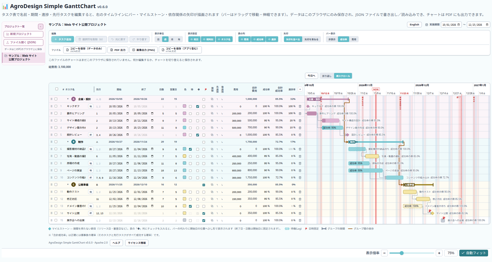
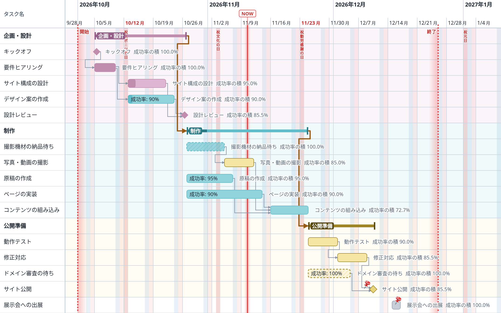
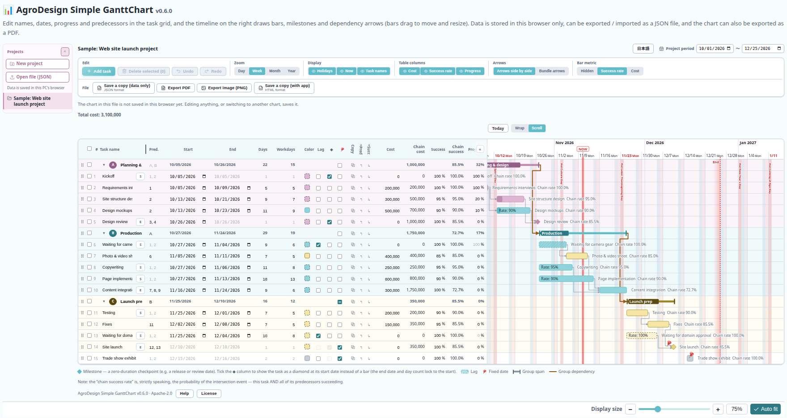
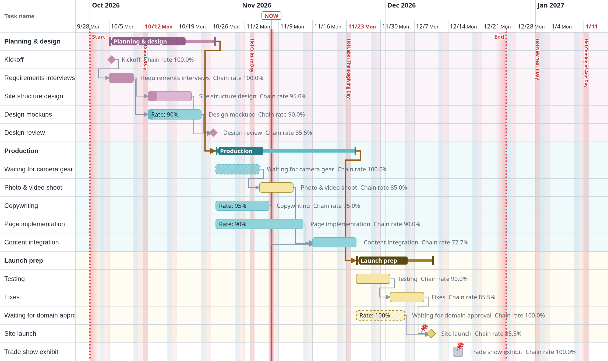

# AgroDesign Simple GanttChart

ブラウザだけで動くガントチャート作成ツールです。インストールもアカウント登録も不要で、HTML ファイル 1 個で動きます。

*English follows below.*

## 稼働サンプル

- **ブラウザで開く（稼働サンプル）**: <https://agrodesign-studios.github.io/Simple-GanttChart/>

開くと、使い方の例としてサンプルのチャート（Web サイト公開プロジェクト）が表示されます。不要になったら、左の一覧の「…」から「削除」で消せます。同じデータは [`sample/sample-project.json`](sample/sample-project.json) にもあり、一覧の「ファイル開く (JSON)」で読み込めます。

## 使い方

- **最新版をダウンロード**: [Releases](https://github.com/AgroDesign-Studios/Simple-GanttChart/releases/latest) から `AgroDesign-Simple-GanttChart-v<バージョン>.html` をダウンロードし、ダブルクリックして開きます。インターネット接続は要りません。ダウンロードしたファイルにサンプルは入っていません。

対応ブラウザは Chrome / Edge / Firefox / Safari（デスクトップ）です。画面下部の「ヘルプ」に操作方法があり、チャート名と同じ行にある「English」で表示言語を切り替えられます。

## できること

- タスクの開始日・終了日、依存関係（先行タスク）、グループ、進捗をもつガントチャートの作成
- 日・週・月の表示切り替え、日本の祝日の表示
- PDF・画像（PNG）への出力
- 「コピーを保存（データのみ）」と「ファイル開く (JSON)」による JSON ファイルでの保存・読み込み（バックアップ、別の PC への移行）
- 「コピーを保存（アプリ含む）」: チャートを埋め込んだ HTML ファイルを作り、そのまま相手に渡せます

出力画像のサンプル（サンプルのチャートを「画像出力 (PNG)」で書き出したもの）:

## データの保存場所

入力した内容は、**お使いのブラウザの中（localStorage）にだけ**保存されます。サーバーには送信されません。

- 別の PC や別のブラウザには引き継がれません。移行や共有には「コピーを保存（データのみ）」を使ってください。
- ブラウザの閲覧データを消去すると、チャートも消えます。大事なチャートは「コピーを保存（データのみ）」で JSON ファイルにして保管してください。
- 一覧の「…」→「削除」は元に戻せません。

## ライセンス

[Apache License 2.0](LICENSE) です。再配布・改変ができます。
同梱している OSS（React、i18next、jsPDF など）の名前・版・ライセンス全文は、画面下部の「ライセンス情報」に載っています。

Copyright 2026 AgroDesign Studios

---

# AgroDesign Simple GanttChart (English)

A Gantt chart tool that runs entirely in your browser. Nothing to install, no account: it is a single HTML file.

## Live sample

- **Open in the browser (live sample)**: <https://agrodesign-studios.github.io/Simple-GanttChart/en/>

It opens with a sample chart (a web site launch project) that shows the features in use. Remove it with "…" → "Delete" in the project list on the left when you no longer need it. The same data is in [`sample/sample-project-en.json`](sample/sample-project-en.json) and can be loaded with "Open file (JSON)" in the project list.

## How to use

- **Download the latest version**: download `AgroDesign-Simple-GanttChart-v<version>.html` from [Releases](https://github.com/AgroDesign-Studios/Simple-GanttChart/releases/latest) and double-click it. No internet connection is needed. The downloaded file contains no sample.

Supported browsers: Chrome, Edge, Firefox and Safari on desktop. "Help" at the bottom of the page explains the controls, and the "English" / "日本語" button on the same line as the chart name switches the language.

## Features

- Gantt charts with start and end dates, dependencies (predecessors), groups and progress
- Day, week and month views; Japanese public holidays
- Export to PDF and PNG
- Saving and opening JSON files with "Save a copy (data only)" and "Open file (JSON)" (backup, moving to another PC)
- "Save a copy (with app)": makes an HTML file with your chart embedded, ready to hand to someone else

Sample output (the sample chart saved with "Export image (PNG)"):

## Where your data lives

Everything you enter is saved **only inside your browser (localStorage)**. Nothing is sent to a server.

- Data does not follow you to another PC or browser. Use "Save a copy (data only)" to move or share a chart.
- Clearing your browser's site data deletes your charts. Keep a "Save a copy (data only)" file of anything important.
- Deleting a project ("…" → "Delete" in the list) cannot be undone.

## License

[Apache License 2.0](LICENSE). You may redistribute and modify it.
The name, version and full licence text of each bundled open-source package (React, i18next, jsPDF and others) is listed under "License" at the bottom of the page.

Copyright 2026 AgroDesign Studios

---

## 更新履歴

各バージョンの主な変更です。ダウンロードは [Releases](https://github.com/AgroDesign-Studios/Simple-GanttChart/releases) から。

### v0.6.0（2026-11-10）
- **新機能**
  - 依存関係の矢印が交差する所で、下を通る線に短い切れ目を入れ、どちらが手前かが分かるようにしました（「矢印を並べる」がオンのとき。選択中の矢印は常に手前）。
  - バーを右クリックすると、編集画面が画面中央ではなくマウスのすぐ横に小さく開きます。よく使う項目が先頭に並び、残りは「詳細を表示」で開きます。
  - 「コピーを保存（アプリ含む）」で作ったファイルは、そのファイルのチャートだけを一覧に表示します（ほかのファイルのチャートと混ざりません）。
- **機能改善**
  - 「矢印を並べる」を作り直しました。矢印の出入り口をバーの高さいっぱいに分け、並行する線は 3 px 間隔で重ならずに並び、束の中で線が交差しなくなりました。
  - 1 本のバーから出る矢印は、上回り・下回りのどちらかにそろえて引きます。
  - 1 本のバーに入る矢印は、バーの十分手前で曲がります。
  - バーの右の文字に淡い縁取りを付け、矢印や罫線の上でも読みやすくしました。
  - 「今日へ」で、今日の線が左端の少し内側に来るようにしました（先の予定が広く見えます）。
- **バグ修正**
  - 矢印の線が重なって 1 本に見える・矢じりの先が丸く見える、などの描画の問題を直しました。
  - PDF・PNG 出力にマウス位置の強調表示が写り込む問題を直しました。
  - PNG 出力の途中でほかの書き出しを押すと処理が止まることがある問題を直しました。

### v0.5.131（2026-11-07）
- **新機能**
  - バーを右クリックすると、その行のすべての項目を 1 つの画面で編集できます。
  - 表の列（費用・成功率・進捗）を列ごとに表示／非表示にでき、各行に削除ボタンが付きました。
  - 表の右端をドラッグして好きな幅にでき、« / » で畳んだあともその幅で開きます。
  - 「コピーを保存（アプリ含む）」で、開いたときの表示をいまの設定にするか既定にするか選べます。
- **機能改善**
  - 依存関係の矢印が、バー・文字・ほかの矢印を避けて引かれます。
  - 見出しを月・NOW・日の 3 段にし、NOW の札が月名に重ならなくなりました。
  - マウスを置いた列のタイトルが光ります。複製・先追加・後追加のボタンに縦書きの名前が付きました。
- **バグ修正**
  - 保存したファイルから開いたチャートにも自動フィットが効くようにしました。
  - PDF・PNG 出力、元に戻す、行の並べ替え、アクセシビリティ、ヘルプの細かな不具合を多数直しました。

### v0.5.76（2026-10-15）
- **バグ修正**: 費用欄を離れると、常に保存されている金額を表示します（打ちかけの入力が新しい金額を隠さなくなりました）。

### v0.5.75（2026-10-15）
- **機能改善**: 費用欄は、入力中は数字を足しても直らない入力だけをエラーにします。エラー文の例の金額は、お使いの数値表記で表示します。

### v0.5.74（2026-10-15）
- **機能改善**: 「先行」に全角で入れた数字・英字も読み取ります。費用欄に数として読めない入力をすると、欄の下に理由を表示します。
- **バグ修正**: 表示倍率が変わって閉じたプロジェクトのメニューが、勝手に開き直さなくなりました。

### v0.5.73（2026-10-15）
- **機能改善**: 費用欄は入力中は区切りなしで表示します。表示倍率のスライダーを 1% 刻みにしました。
- **バグ修正**: 自動フィットが 2 つの大きさを行き来する問題と、キーボードで移った入力欄が表示倍率バーに隠れる問題を直しました。

### v0.5.72（2026-10-15）
- **新機能**: 画面右下に表示倍率のスライダー（50〜150%）と「自動フィット」を付けました。
- **機能改善**: « / » ボタンを表の見えている右端に表示します。現時刻の札を「NOW」に統一し、費用欄を 3 桁区切りにし、実施期間の線を点線にしました。

### v0.5.71（2026-10-15）
- **バグ修正**: 折り返し表示で現時刻の札が 2 つ並ぶときも、PDF のページ左端の月名が札に重ならないようにしました。

### v0.5.70（2026-10-15）
- **バグ修正**: PDF のページ左端の月名が現時刻の札に重なる問題と、幅の狭い画面で今日の位置がタスク名の列に隠れる問題を直しました。

### v0.5.69（2026-10-15）
- **新機能**: 幅の狭い画面で横スクロールするとき、タスク名の列が左端に固定されます。
- **機能改善**: PDF の 2 ページ目以降にも月の名前が出ます。言語切替ボタンをチャート名と同じ行に移しました。JSON を読み込んだときも今日の位置へ移動します。

### v0.5.64（2026-10-14）
- **機能改善**: 横スクロールで開くと今日の位置まで移動します。実施期間と言語切替ボタンを右端にまとめました。
- **バグ修正**: 折り返し表示の月の見出しが段からはみ出したり、現時刻の札と重なったりする問題を直しました。

### v0.5.62（2026-10-14）
- **新機能**: プロジェクトを左の折りたためる一覧にし、名前変更・複製・削除と最終更新日を付けました。「表示設定」で祝日・現時刻・タスク名の表示を切り替えられます。
- **機能改善**: 書き出しを「コピーを保存（データのみ）」「コピーを保存（アプリ含む）」に改め、「全消去」を選択列の一括チェックに置き換えました。今日の線に後光と「現時刻」の印を付けました。
- **注意**: このバージョンで保存したチャートは、v0.5.60 以前のファイルでは保存できません（表示はできます）。

### v0.5.59（2026-10-14）
- **機能改善**: ツールバーを見出しとアイコンつきのグループに整理しました。幅 768px 以下ではチャートが画面幅に収まり、折り返し表示で開きます。

### v0.5.57（2026-10-13）
- **機能改善**: 初期表示を横スクロールにし、言語切替ボタンを最上段の右端に移しました。ライセンス情報にこのリポジトリへのリンクを付けました。

### v0.5.56（2026-10-13）
- 最初の公開版です。

---

## Release notes

The main changes in each version. Downloads are on the [Releases](https://github.com/AgroDesign-Studios/Simple-GanttChart/releases) page.

### v0.6.0 (2026-11-10)
- **New**
  - Where two dependency arrows cross, the one passing under has a short break, so you can tell which is in front ("Arrows side by side" on; a picked arrow is always in front).
  - Right-clicking a bar opens a small editor right beside the pointer instead of a dialog in the middle of the screen; the common fields come first, the rest under "More fields".
  - A file made with "Save a copy (with app)" lists only its own charts, never those of other files.
- **Improved**
  - "Arrows side by side" redone: arrows leave and enter a bar spread over its height, parallel lines run 3 px apart without overlapping, and a bundle never crosses itself.
  - The arrows leaving one bar all go the same way round, over the top or down the trunk.
  - Arrows into one bar turn well before it.
  - Bar labels have a light halo, so they stay readable over arrows and grid lines.
  - "Today" puts the today line a little in from the left edge, so more of what is ahead is in view.
- **Fixed**
  - Arrow lines drawn on top of each other and blunt-looking arrowheads.
  - The mouse-over highlight showing up in PDF and PNG exports.
  - A PNG export pressed during another export could stall later exports.

### v0.5.131 (2026-11-07)
- **New**
  - Right-click a bar to edit its whole row in one dialog.
  - Cost, Success rate and Progress columns can each be shown or hidden; each row has a delete button.
  - Drag the table's right edge to any width; « / » folds it and reopens it at that width.
  - "Save a copy (with app)" can open with your current view settings or the defaults.
- **Improved**
  - Dependency arrows are routed around bars, labels and other arrows.
  - The header has three rows (month, NOW, day), so the NOW tag no longer covers month names.
  - The column under the mouse lights its heading; the copy / add buttons are labelled vertically.
- **Fixed**
  - Auto fit also fits a chart that opens from a saved file.
  - Many smaller fixes to PDF / PNG export, undo, row dragging, accessibility and help.

### v0.5.76 (2026-10-15)
- **Fixed**: leaving a cost field always shows the amount actually saved.

### v0.5.75 (2026-10-15)
- **Improved**: while you type a cost, only text that more digits cannot fix is marked; the error's example follows your number format.

### v0.5.74 (2026-10-15)
- **Improved**: full-width digits and letters in Pred. are read; a cost that is not a number says why under the field.
- **Fixed**: a project menu closed by a display-size change no longer reopens by itself.

### v0.5.73 (2026-10-15)
- **Improved**: the cost field shows plain digits while you edit; the size slider moves in 1% steps.
- **Fixed**: Auto fit flipping between two sizes, and fields hidden under the Display size bar.

### v0.5.72 (2026-10-15)
- **New**: a Display size slider (50-150%) and Auto fit at the bottom right.
- **Improved**: the « / » button floats at the table's visible edge; the today tag reads NOW; costs group thousands; the period lines are dotted.

### v0.5.71 (2026-10-15)
- **Fixed**: a PDF page's month name clears both NOW tags when two sit side by side.

### v0.5.70 (2026-10-15)
- **Fixed**: a PDF page's month name covering the NOW tag; today hidden under the frozen name column on narrow screens.

### v0.5.69 (2026-10-15)
- **New**: on narrow screens the task names stay frozen at the left while the chart scrolls.
- **Improved**: every PDF page shows its month name; the language button sits beside the chart name; loading JSON moves to today.

### v0.5.64 (2026-10-14)
- **Improved**: Scroll mode opens at today; the period pickers and language button sit together at the right.
- **Fixed**: month names in wrapped rows overflowing their row or covering the Now tag.

### v0.5.62 (2026-10-14)
- **New**: projects in a collapsible list on the left, with rename, duplicate, delete and last-changed dates; a Display group to show or hide holidays, Now and task names.
- **Improved**: "Save a copy (data only / with app)" replace the old export buttons; "Clear all" became a select-all box; the today line has a glow and a Now tag.
- **Note**: charts saved by this version can be viewed but not saved by v0.5.60 and earlier files.

### v0.5.59 (2026-10-14)
- **Improved**: the toolbar is grouped under captions with icons; on windows of 768px or less the chart fits the width and opens wrapped.

### v0.5.57 (2026-10-13)
- **Improved**: opens in Scroll mode; the language button moved to the top right; the license dialog links to this repository.

### v0.5.56 (2026-10-13)
- First public version.
