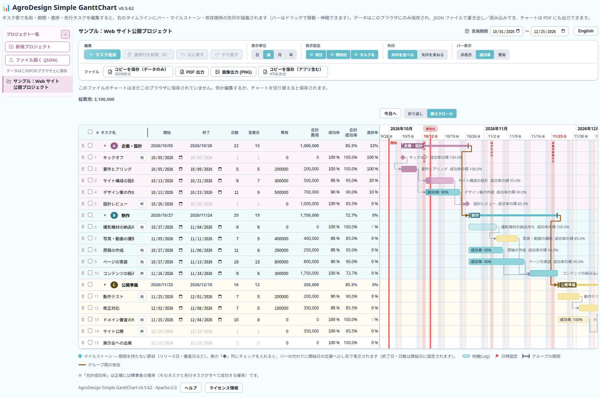
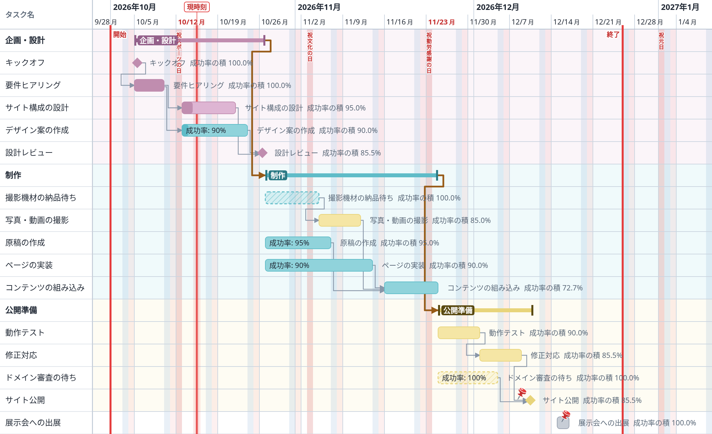
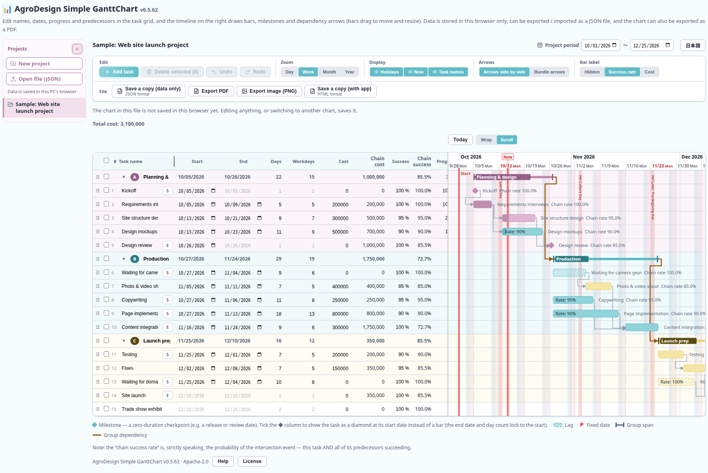
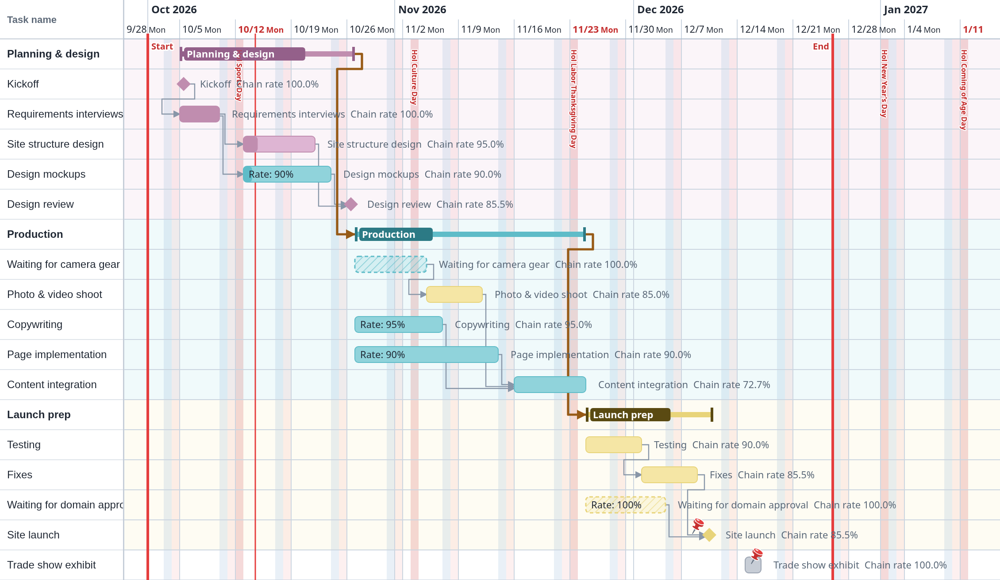

# AgroDesign Simple GanttChart

ブラウザだけで動くガントチャート作成ツールです。インストールもアカウント登録も不要で、HTML ファイル 1 個で動きます。

*English follows below.*

## 稼働サンプル

- **ブラウザで開く（稼働サンプル）**: <https://agrodesign-studios.github.io/Simple-GanttChart/>

開くと、使い方の例としてサンプルのチャート（Web サイト公開プロジェクト）が表示されます。不要になったら、左の一覧の「…」から「削除」で消せます。同じデータは [`sample/sample-project.json`](sample/sample-project.json) にもあり、一覧の「ファイル開く (JSON)」で読み込めます。

## 使い方

- **最新版をダウンロード**: [Releases](https://github.com/AgroDesign-Studios/Simple-GanttChart/releases/latest) から `AgroDesign-Simple-GanttChart-v<バージョン>.html` をダウンロードし、ダブルクリックして開きます。インターネット接続は要りません。ダウンロードしたファイルにサンプルは入っていません。

対応ブラウザは Chrome / Edge / Firefox / Safari（デスクトップ）です。画面下部の「ヘルプ」に操作方法があり、最上段の右端の「English」で表示言語を切り替えられます。

## できること

- タスクの開始日・終了日、依存関係（先行タスク）、グループ、進捗をもつガントチャートの作成
- 日・週・月の表示切り替え、日本の祝日の表示
- PDF・画像（PNG）への出力
- 「コピーを保存（データのみ）」と「ファイル開く (JSON)」による JSON ファイルでの保存・読み込み（バックアップ、別の PC への移行）
- 「コピーを保存（アプリ含む）」: チャートを埋め込んだ HTML ファイルを作り、そのまま相手に渡せます

出力画像のサンプル（サンプルのチャートを「画像出力 (PNG)」で書き出したもの）:

## データの保存場所

入力した内容は、**お使いのブラウザの中（localStorage）にだけ**保存されます。サーバーには送信されません。

- 別の PC や別のブラウザには引き継がれません。移行や共有には「コピーを保存（データのみ）」を使ってください。
- ブラウザの閲覧データを消去すると、チャートも消えます。大事なチャートは「コピーを保存（データのみ）」で JSON ファイルにして保管してください。
- 一覧の「…」→「削除」は元に戻せません。

## ライセンス

[Apache License 2.0](LICENSE) です。再配布・改変ができます。
同梱している OSS（React、i18next、jsPDF など）の名前・版・ライセンス全文は、画面下部の「ライセンス情報」に載っています。

Copyright 2026 AgroDesign Studios

---

# AgroDesign Simple GanttChart (English)

A Gantt chart tool that runs entirely in your browser. Nothing to install, no account: it is a single HTML file.

## Live sample

- **Open in the browser (live sample)**: <https://agrodesign-studios.github.io/Simple-GanttChart/en/>

It opens with a sample chart (a web site launch project) that shows the features in use. Remove it with "…" → "Delete" in the project list on the left when you no longer need it. The same data is in [`sample/sample-project-en.json`](sample/sample-project-en.json) and can be loaded with "Open file (JSON)" in the project list.

## How to use

- **Download the latest version**: download `AgroDesign-Simple-GanttChart-v<version>.html` from [Releases](https://github.com/AgroDesign-Studios/Simple-GanttChart/releases/latest) and double-click it. No internet connection is needed. The downloaded file contains no sample.

Supported browsers: Chrome, Edge, Firefox and Safari on desktop. "Help" at the bottom of the page explains the controls, and the "English" / "日本語" button at the right end of the first row switches the language.

## Features

- Gantt charts with start and end dates, dependencies (predecessors), groups and progress
- Day, week and month views; Japanese public holidays
- Export to PDF and PNG
- Saving and opening JSON files with "Save a copy (data only)" and "Open file (JSON)" (backup, moving to another PC)
- "Save a copy (with app)": makes an HTML file with your chart embedded, ready to hand to someone else

Sample output (the sample chart saved with "Export image (PNG)"):

## Where your data lives

Everything you enter is saved **only inside your browser (localStorage)**. Nothing is sent to a server.

- Data does not follow you to another PC or browser. Use "Save a copy (data only)" to move or share a chart.
- Clearing your browser's site data deletes your charts. Keep a "Save a copy (data only)" file of anything important.
- Deleting a project ("…" → "Delete" in the list) cannot be undone.

## License

[Apache License 2.0](LICENSE). You may redistribute and modify it.
The name, version and full licence text of each bundled open-source package (React, i18next, jsPDF and others) is listed under "License" at the bottom of the page.

Copyright 2026 AgroDesign Studios
